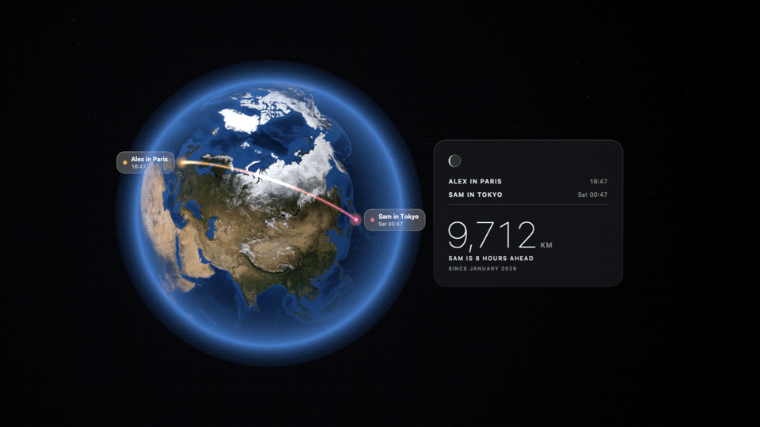
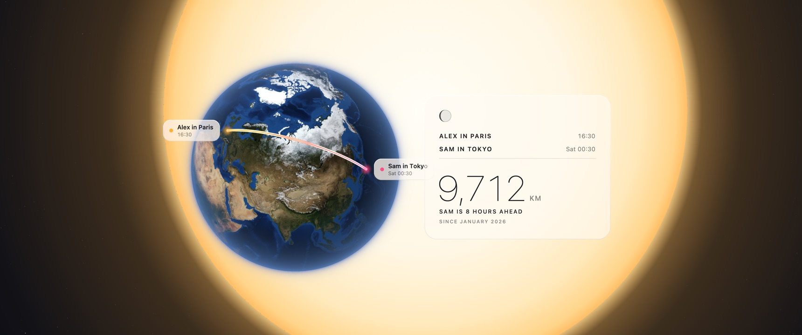
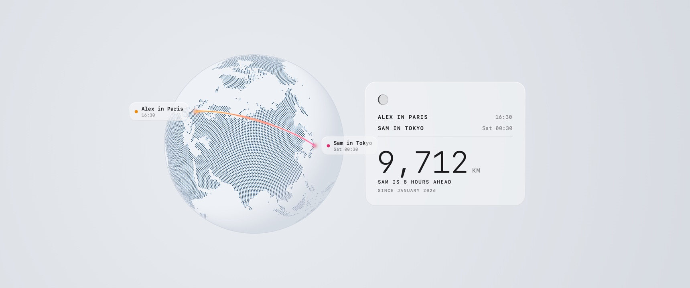

# Global

**A living globe for two, as your Mac's desktop background.**

Global turns your desktop into a slowly turning 3D Earth that shows where
you and your partner are, the arc between you, how far apart you are and
the time for each of you. It's made for long-distance couples, friends
and family.



<sub>One full *Spin, Then Settle* cycle in Realistic Dark, sped up 15×. On
your desktop it takes about three minutes.</sub>

## Download

**[Download Global for Mac](https://github.com/NE0NMIKE/global/releases/latest/download/Global.dmg)**
(macOS 13 or later, Apple silicon or Intel)

1. Open **Global.dmg** and drag **Global** onto the **Applications** folder.
2. Open **Applications** and double-click **Global**.
3. macOS will say it can't check Global for malware, because Global isn't
   from the App Store. Click **Done**, then:
   - open **System Settings › Privacy & Security**,
   - scroll down to *"Global" was blocked*, click **Open Anyway**, and
     enter your password.

   You only need to do this once.
4. Type your name, your partner's name and their city, then click **Start**.
   Click **Allow** when macOS asks about Location, so Global can find your
   own city.

Global then lives in the menu bar (the globe icon). Use it to change the
style, pause the animation, or open **Settings…**.

## Features

<table>
  <tr>
    <td></td>
    <td></td>
  </tr>
</table>

- **Four styles:** Realistic (NASA Blue and Black Marble imagery), Dot
  Matrix, Line Art and Silhouette. Each has a **Dark** version, with the
  globe floating in space, and a **Light** version. In Light, Realistic sits
  in front of a giant sun and the others use soft off-white tones. Or choose
  **Match System**.
- **Motion:** *Framed on Both of You* (a gentle sway) or *Spin, Then Settle*
  (one slow turn, then it eases back to frame you both).
- **Info panel** beside the globe: both of you, your local times, the
  distance, the time difference, the moon phase and an optional "Since …"
  date. Optional name tags on the globe itself.
- **Day and night:** shade the side of the Earth where it's night, using the
  real position of the sun.
- **Private:** your Mac finds its own city (rounded to about 11 km), and it
  never leaves your Mac. Your partner's city is something you type in. There
  are no accounts, servers or tracking.
- **Light on battery:** only the globe is redrawn, and its frame rate drops
  when it moves slowly. It pauses on battery or in Low Power Mode (you can
  turn this off), while displays sleep, and when a display is fully covered.

Global draws on every display and every Space. Desktop icons stay visible
and clickable on top of it.

## Privacy

- Your location is used only to place your own marker. It's rounded to one
  decimal place (about 11 km) and stored only on your Mac.
- City names are turned into coordinates by Apple's geocoder, the same
  service that Maps uses.
- Global has no analytics and makes no other network requests.

## Build from source

Requires a Swift 6.1 toolchain. Command Line Tools are enough
(`xcode-select --install`).

```sh
scripts/run.sh               # build Global.app (release), then (re)launch it
scripts/build-app.sh         # build only → build/Global.app
scripts/package.sh           # universal build → build/Global.dmg
scripts/make-demo.sh         # README animation → docs/demo.gif
swift test                   # unit tests (Swift Testing)
```

Preview the styles without installing the wallpaper:

```sh
swift build
.build/debug/Global --snapshot /tmp/global-shots --size 1600x1000
#   options: --style realistic|dotMatrix|lineArt|silhouette  --dark | --light
#            --daynight  --tags  --nopanel  --spin  --time <seconds>
```

Debug builds also accept commands from the terminal. These hooks are
compiled out of release builds:

```sh
scripts/debug-command.sh style=dotMatrix appearance=light   # change settings
scripts/debug-command.sh welcome=1                          # show the welcome window
scripts/debug-snapshot.sh                                   # save each display's live frame
```

### Notes

- macOS has no public live-wallpaper API. Global draws in a borderless,
  click-through window at desktop level.
- Macs locate using Wi-Fi, so your position updates only while the Mac is
  awake and online. If Location is off, set **Your city** in
  **Settings › Location** instead.
- Releases are ad-hoc signed, not notarised, which is why the one-time
  **Open Anyway** step is needed. With a Developer ID, sign with
  `SIGN_IDENTITY="…" scripts/package.sh`.
- Liquid Glass: the app is built against the macOS 15.5 SDK, so Settings
  uses system materials. `GlassStyle.swift` switches to `glassEffect`
  automatically with the macOS 26 SDK (Swift 6.2+).

### Project layout

```
Sources/Global/
  App/         entry point, AppDelegate, AppModel (coordinator), settings, snapshot tool
  Globe/       SceneKit scene, themes, geometry, shaders, motion
  Overlay/     info panel and tag bitmaps (AppKit text), tags as scene nodes
  Wallpaper/   desktop-level windows, layered wallpaper view, SCNView, power monitoring
  Location/    Core Location wrapper (rounding, geocoding), city lookup
  Menu/        menu bar item
  Settings/    welcome window and Settings (SwiftUI forms, glass card style)
  Geo/         spherical maths, sun position, Natural Earth land data
Resources/     NASA textures, Natural Earth GeoJSON
scripts/       build, run, package, icon, debug helpers
Tests/         Swift Testing unit tests
```

## Credits

- Earth imagery: [NASA Visible Earth](https://visibleearth.nasa.gov/)
  (Blue Marble, Black Marble), public domain.
- Coastlines and borders: [Natural Earth](https://www.naturalearthdata.com/),
  public domain.

## Contact

Questions, ideas or bugs? [Open an issue](https://github.com/NE0NMIKE/global/issues)
or email [312m.ye@gmail.com](mailto:312m.ye@gmail.com).

## Licence

[MIT](LICENSE)
